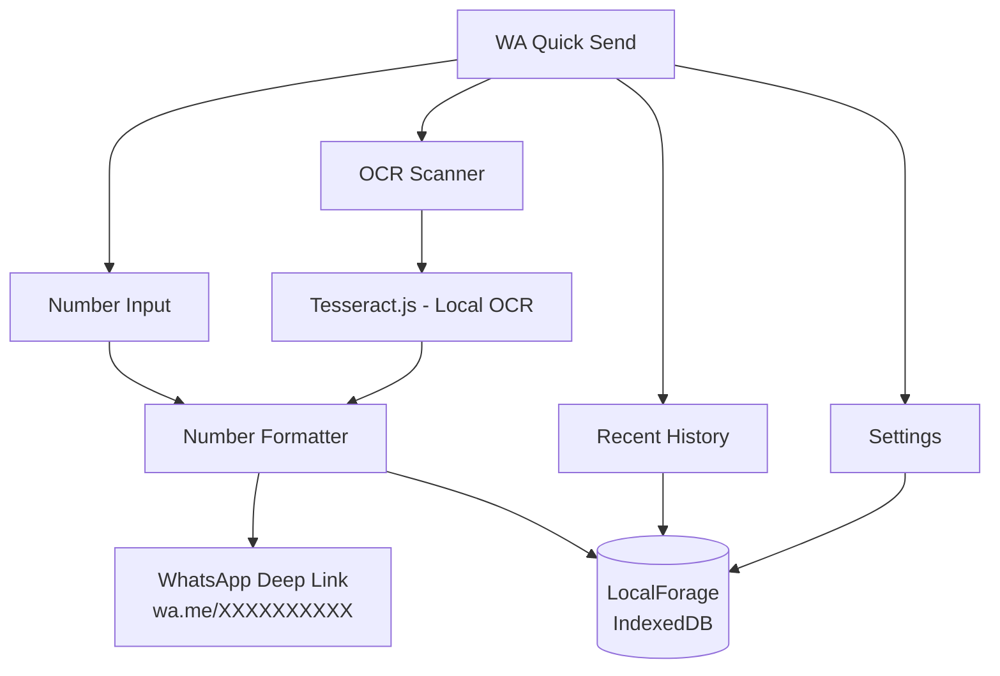

<div align="center">
  
  <h1>WA Quick Send</h1>
  <p><strong>Send WhatsApp messages to any number — instantly. No saving. No clutter.</strong></p>

  <p>
    <a href="#"><b>Live App</b></a> ·
    <a href="#-features">Features</a> ·
    <a href="#-tech-stack">Tech Stack</a> ·
    <a href="#-getting-started">Getting Started</a> ·
    <a href="#-roadmap">Roadmap</a>
  </p>

  
  
  
  
</div>

---

**WA Quick Send** is a lightweight, privacy-first web utility that eliminates the most common friction in WhatsApp messaging — the need to save a contact before you can message them.

Type a number, scan a business card, or tap a recent contact. One tap opens a WhatsApp chat, with your message pre-filled. No phonebook clutter. No account. No data leaving your device.

> WA Quick Send is a deep-link utility — not a messaging client or WhatsApp wrapper. All actual communication goes through the user's installed WhatsApp app.

---

## ✨ Features

### ⚡ Instant Click-to-Chat
- **Smart Number Input** — Accepts numbers in any format: with/without country code, spaces, or dashes
- **Pre-filled Messaging** — Draft your message before opening WhatsApp so it lands pre-typed and ready to send

### 📷 OCR Number Scanning
- **Camera Integration** — Point your camera at a business card, flyer, or any physical surface
- **Image Upload** — Pick a screenshot or photo from your gallery
- **Smart Extraction** — Tesseract.js reads the image locally, identifies phone numbers, and auto-fills the input — all on-device, no server involved

### 🕒 Local Recent History
- **Recent Numbers List** — A fast, scrollable list of numbers you've messaged
- **Contact Naming** — Tag unknown numbers with custom names for easy future reference
- **One-Tap Reconnect** — Follow up with any number without re-scanning or re-entering
- **Fully Private** — History is stored in IndexedDB on your device

### ⚙️ Customizable Settings & Data Control
- **Default Country Code** — Configure your local country code so you never have to type it again
- **Export Data** — Download your entire chat history as a CSV file for backup or spreadsheets
- **Clear History** — Wipe all local device data instantly with one tap

---

## 🏗️ Architecture



**How it works:**
- **Number Formatter:** Strips non-numeric characters, applies your default country code, and constructs a `https://wa.me/` deep link.
- **OCR Scanner:** Tesseract.js runs entirely in the browser via WebAssembly. Images are never uploaded anywhere.
- **Local Storage:** `localforage` wraps IndexedDB to securely persist recent contacts, names, and settings locally on your device.

---

## 🛠️ Tech Stack

| Layer | Technology | Why |
|-------|-----------|-----|
| UI Framework | React 19 | Component-based, fast, wide ecosystem |
| Build Tool | Vite 8 | Instant dev server, optimized builds |
| OCR | Tesseract.js 7 | 100% local, WebAssembly-powered text recognition |
| Storage | localforage (IndexedDB) | Async local history without cloud dependency |
| Icons | lucide-react | Clean, modern, tree-shakable icon set |
| Styling | Vanilla CSS | Custom premium dark UI, smooth animations |

---

## 🚀 Getting Started

### Prerequisites
- Node.js v18+
- npm

### Setup

```bash
# Clone the repository
git clone https://github.com/sumitrawat2417/whatsapp-quick-send.git
cd whatsapp-quick-send

# Install dependencies
npm install

# Start development server
npm run dev
# → http://localhost:5173
```

---

## 🔮 Roadmap

| Feature | Status |
|---------|--------|
| Manual number input + WhatsApp deep link | ✅ Complete |
| Pre-filled message input | ✅ Complete |
| Local recent history | ✅ Complete |
| Contact Naming / Aliasing | ✅ Complete |
| OCR camera scan (Tesseract.js) | ✅ Complete |
| Image upload OCR | ✅ Complete |
| Settings: Default Country Code | ✅ Complete |
| Export Data to CSV | ✅ Complete |
| PWA manifest + offline support | 🔲 Planned |
| Multi-number extraction from images | 🔲 Future |
| Native share target (Receive numbers from other apps) | 🔲 Future |
| Message templates | 🔲 Future |

---

## 🤝 Contributing

Contributions, issues, and feature requests are welcome!
Feel free to open an [issue](https://github.com/sumitrawat2417/whatsapp-quick-send/issues) or submit a pull request.

---

## ⚖️ License

This project is licensed under the **MIT License** — see the [LICENSE](./LICENSE) file for details.

---

<div align="center">
  <p><em>Built by <a href="https://github.com/sumitrawat2417">Forbit (Sumit Rawat)</a></em></p>
  <p><sub>Not affiliated with WhatsApp or Meta.</sub></p>
</div>
