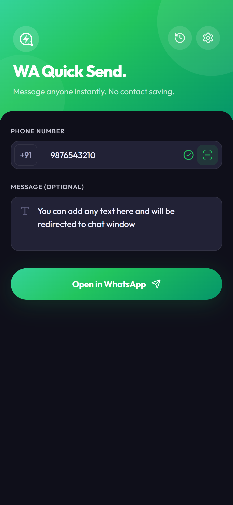
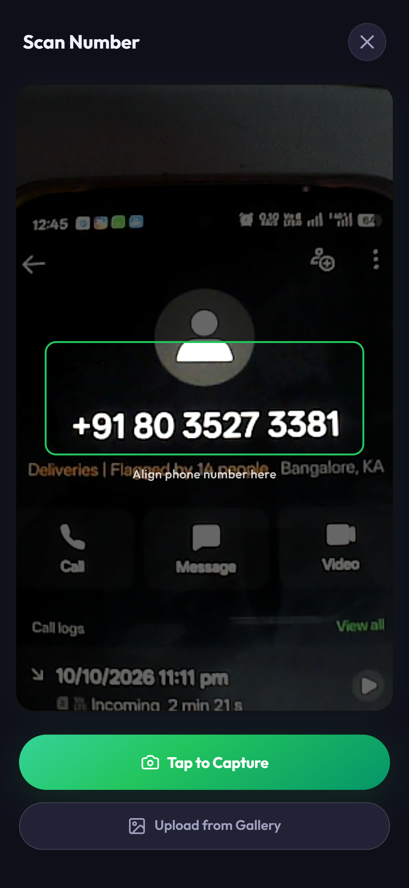
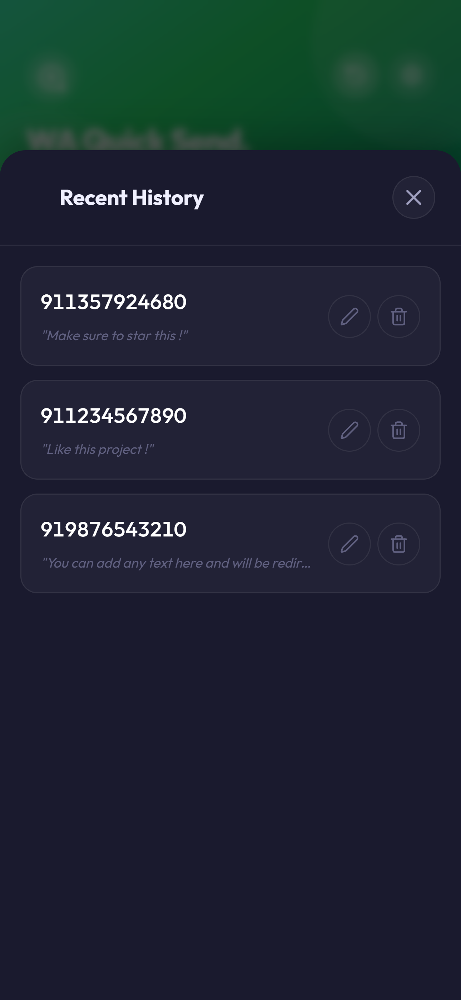
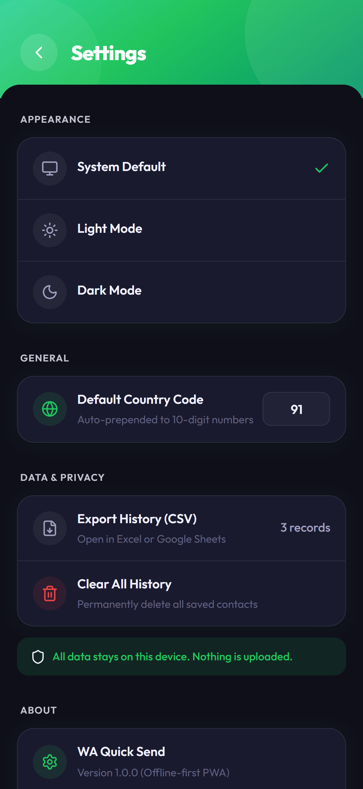
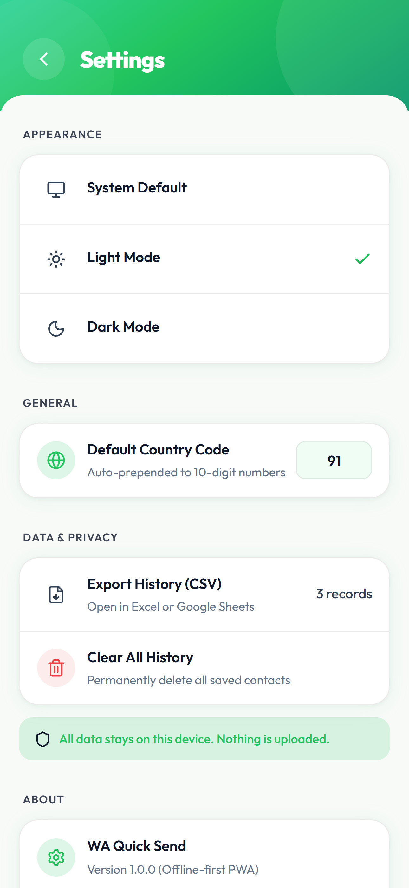
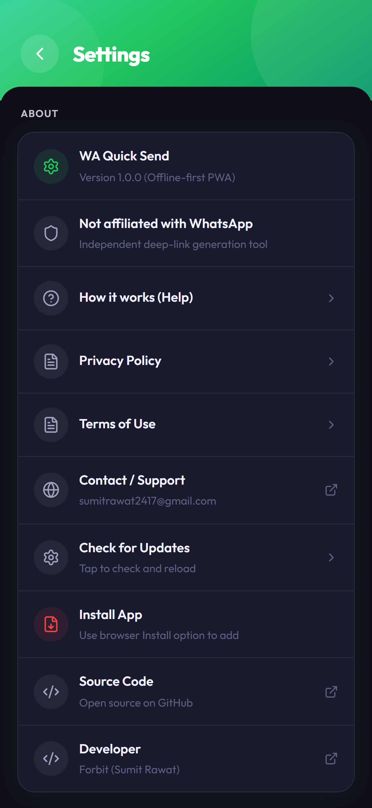
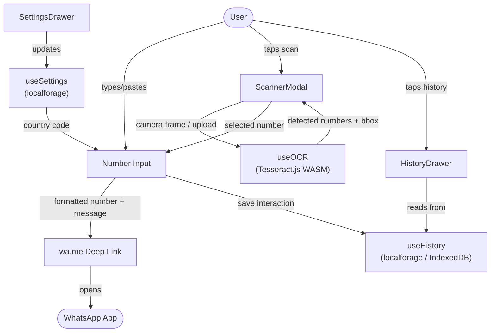

<div align="center">


# WA Quick Send

### Send WhatsApp messages to anyone, instantly — no saving required.

[](https://sumitrawat2417.github.io/whatsapp-quick-send/)
[](./LICENSE)
[](https://github.com/sumitrawat2417/whatsapp-quick-send)

[](https://react.dev)
[](https://vite.dev)
[](https://tesseract.projectnaptha.com/)
[](https://sumitrawat2417.github.io/whatsapp-quick-send/)

</div>

---

## 📖 What is WA Quick Send?

**WA Quick Send** eliminates the #1 friction in WhatsApp — having to save a temporary contact just to send one message.

> Delivery agent sharing their number? Vendor from a screenshot? Number on a business card? Just paste it, scan it, or type it. One tap. Done. No phonebook clutter. No account needed.

It is a **100% client-side web app** built on WhatsApp's official `wa.me` deep link API. All processing — OCR scanning, history, settings — happens locally on your device. Nothing ever leaves your browser.

---

## 📸 Screenshots

<div align="center">

| Home | Live Scan | History | Settings |
|------|-----------|---------|----------|
|  |  |  |  |

| Light Theme | Settings (More) |
|-------------|-----------------|
|  |  |

</div>

---

## ✨ Features

### ⚡ Instant Click-to-Chat
Type a number in any format — spaces, dashes, country codes — and hit **Open in WhatsApp**. The app cleans it up, applies your default country code automatically, and launches a WhatsApp chat in one tap.

### 📷 Point-and-Click OCR Scanner (Live Text)
Our most powerful feature. No more copying and pasting numbers from screenshots manually:

1. **Capture** a photo with your camera, or **upload** an image from your gallery.
2. The app runs **Tesseract.js** (WebAssembly OCR) locally and scans the image.
3. Every detected phone number gets a **glowing green bounding box** drawn precisely over it.
4. **Tap the box** to instantly select that number — perfect when multiple numbers are visible.

This is like Apple's "Live Text" or Google Lens, built directly into your browser, with zero cloud involvement.

### 🕒 Recent History (Local & Private)
- Every number you open is automatically saved to **IndexedDB** on your device.
- Add **custom names/labels** to unknown numbers for quick future reference.
- **One-tap reconnect** — no re-typing, no re-scanning.
- **Export to CSV** — download your full history for backup or spreadsheet use.
- **Wipe data** instantly with a single button.

### ⚙️ Smart Settings
- **Default Country Code** — set once, never type `+91` again.
- Auto-formats all 10-digit numbers using your configured prefix.
- **Green validation tick** — appears as soon as a number looks correct.
- **Theme toggle** — Dark, Light, or follow System preference.

### 📚 Built-in Documentation
- Full **Privacy Policy**, **Terms of Use**, and **How it Works** guide accessible directly inside the app — no need to leave to a separate website.

---

## 🏗️ Architecture

```
whatsapp-quick-send/
├── src/
│   ├── App.jsx              # Root component: form, number input, send logic
│   ├── App.css              # Core layout, variables, design tokens
│   ├── index.css            # Global resets, typography, theme
│   │
│   ├── ScannerModal.jsx     # Live Text OCR scanner (camera + upload + overlays)
│   ├── ScannerModal.css
│   │
│   ├── HistoryDrawer.jsx    # Slide-in panel for recent contacts + naming
│   ├── HistoryDrawer.css
│   │
│   ├── SettingsDrawer.jsx   # Theme, country code, data management
│   ├── SettingsDrawer.css
│   │
│   ├── LegalModal.jsx       # Renders Privacy / Terms / How it works via Markdown
│   ├── LegalModal.css
│   │
│   ├── useOCR.js            # Custom hook: Tesseract.js + bounding box extraction
│   ├── useHistory.js        # Custom hook: IndexedDB CRUD via localforage
│   └── useSettings.js       # Custom hook: persistent app settings
│
├── docs/
│   ├── privacy_policy.md
│   ├── terms_and_conditions.md
│   └── how_it_works.md
│
├── img/                     # Screenshots for README
├── public/
│   └── favicon.svg          # App logo
└── index.html
```

### Data Flow



---

## 🛠️ Tech Stack

| Layer | Technology | Role |
|-------|-----------|------|
| **UI Framework** | React 19 | Component architecture, hooks, state management |
| **Build Tool** | Vite 8 | Lightning-fast dev server and optimized production build |
| **OCR Engine** | Tesseract.js 7 | 100% local WebAssembly text recognition with bounding boxes |
| **Storage** | localforage (IndexedDB) | Async local persistence — history, names, settings |
| **Markdown Renderer** | react-markdown + remark-gfm | Renders in-app legal and help docs from `.md` files |
| **Icons** | lucide-react | Clean, tree-shakable modern icon set |
| **Styling** | Vanilla CSS | Premium custom dark/light UI with CSS variables and animations |
| **Deployment** | GitHub Pages | Free, fast, zero-config static hosting |

---

## 🚀 Getting Started

### Prerequisites
- **Node.js** v18+
- **npm** v9+

### Local Development

```bash
# 1. Clone the repository
git clone https://github.com/sumitrawat2417/whatsapp-quick-send.git
cd whatsapp-quick-send

# 2. Install dependencies
npm install

# 3. Start the dev server
npm run dev
# → Open http://localhost:5173
```

### Production Build

```bash
npm run build
# Output goes to /dist
```

---

## 📱 Install on Mobile (PWA-style)

Since WA Quick Send is a web app, you can add it to your home screen for a native app experience:

**On Android (Chrome):**
1. Open [the live app](https://sumitrawat2417.github.io/whatsapp-quick-send/) in Chrome.
2. Tap the **three-dot menu** → **"Add to Home screen"**.
3. Tap **Add**. Done — it opens like a native app, full screen, no browser chrome.

**On iPhone (Safari):**
1. Open the live app in **Safari**.
2. Tap the **Share button** (box with arrow) at the bottom.
3. Scroll down and tap **"Add to Home Screen"**.
4. Tap **Add**. The app icon now lives on your home screen.

> **Tip:** Once added to your home screen, the app loads instantly and feels indistinguishable from a native app.

---

## 🔮 Roadmap

| Feature | Status |
|---------|--------|
| Manual number input + WhatsApp deep link | ✅ Done |
| Pre-filled message input | ✅ Done |
| Local recent history (IndexedDB) | ✅ Done |
| Contact naming / aliasing | ✅ Done |
| OCR camera capture (Tesseract.js) | ✅ Done |
| Image upload OCR | ✅ Done |
| **Live Text** — clickable bounding box overlays | ✅ Done |
| Default country code + 10-digit validation | ✅ Done |
| Green format-valid tick indicator | ✅ Done |
| Export history to CSV | ✅ Done |
| Theme toggle (Dark / Light / System) | ✅ Done |
| In-app Privacy Policy, Terms & How-it-works | ✅ Done |
| Camera auto-shutdown on modal close | ✅ Done |
| PWA manifest + offline support | 🔲 Planned |
| Native Share Target (receive numbers from other apps) | 🔲 Future |
| Message templates | 🔲 Future |

---

## 🔒 Privacy

WA Quick Send is designed to be **100% private by default**:

- ❌ No backend server
- ❌ No analytics or tracking
- ❌ No account or sign-in required
- ❌ Images captured by the OCR scanner are **never uploaded** anywhere
- ✅ All data (history, settings) lives in **your browser's IndexedDB**
- ✅ Wipe everything instantly from the Settings screen

The app is purely a client-side tool that constructs a `https://wa.me/` URL and opens it. No messages pass through our code.

---

## 🤝 Contributing

This is an open-source project — contributions, bug reports, and feature ideas are warmly welcome!

```bash
# Fork → Clone → Branch → PR
git checkout -b feat/your-feature-name
```

- Open an [Issue](https://github.com/sumitrawat2417/whatsapp-quick-send/issues) for bugs or feature requests
- Submit a [Pull Request](https://github.com/sumitrawat2417/whatsapp-quick-send/pulls) for improvements

---

## ⚖️ License

This project is open source under the **MIT License** — see the [LICENSE](./LICENSE) file for full details.

---

<div align="center">

Built with ❤️ by **[Forbit (Sumit Rawat)](https://github.com/sumitrawat2417)**

*Not affiliated with, endorsed by, or connected to WhatsApp Inc. or Meta Platforms, Inc.*

⭐ **If this saved you time, drop a star!** ⭐

</div>
